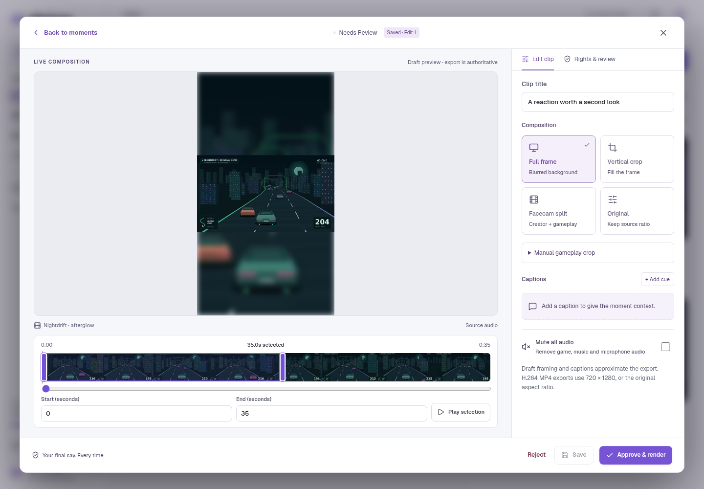

# Cliplane

Turn authorized gameplay and stream recordings into clips you can edit, review and
download. Upload a recording, pick a suggested moment, frame and caption it, then
review its rights and approve the exact revision before rendering an MP4.


[Watch the 45-second demo](docs/demos/cliplane-demo.mp4) · [Demo notes](docs/demos/README.md) · [Verification](docs/verification.md)

The demo follows a real edit, rights review, render and download using original
synthetic footage. It ends with the downloaded vertical export.

## Quickstart

Use Linux, macOS or WSL2 with Node.js 22.12+, Python 3.12+ (`python3`), FFmpeg with
`libx264` and `drawtext`, ffprobe, and Docker Compose for PostgreSQL 17. For an existing
PostgreSQL 17+ instance, set `DATABASE_URL` in `.env` and skip `npm run db:up`.

```sh
git clone https://github.com/jaydenpiao/cliplane.git
cd cliplane
npm ci
cp .env.example .env
npm run db:up
npm run db:migrate
npm run seed
npm run dev
```

Open [http://localhost:3000](http://localhost:3000) and choose **Explore the sample
studio**. Create your own workspace for private footage. The sample workspace is
shared development data, and seeding preserves existing sample recordings.

### Cloud development preview

Run the same commands in a remote development session. The web server binds to
`0.0.0.0:3000` and proxies `/api` to the API on loopback port 4000. Check readiness
at `http://localhost:3000/api/health` from inside the session. To open the studio
from outside the session, use a viewer or preview URL supplied by the development
environment that opens the studio as a top-level page. Cliplane blocks iframe
embedding.

For a forwarded preview, set `APP_ORIGIN` in `.env` to the browser's exact origin
(scheme, hostname and any explicit port). Add the exact preview hostname to
`allowedDevOrigins` in your local [Next.js config](apps/web/next.config.ts) so
development hot reload can connect. Use the hostname alone, without a scheme,
port or wildcard. Restart `npm run dev` to apply both settings. Keep the preview
private. This setup is for development only. See
[deployment requirements](#deployment-and-media-isolation) for public hosting.

## The clipping workflow

1. **Import and analyze.** Stream an MP4, MOV, MKV, WebM or AVI recording into a
   private workspace. Cliplane probes the file, preserves the original, creates a
   playback proxy and ranks up to eight moments using audio and scene signals.
   PostgreSQL tracks job progress and retries.
2. **Edit a moment.** Scrub the source filmstrip, trim with pointer or keyboard
   controls, and compose in the original aspect ratio or 9:16 with crop, blur or
   facecam layouts. Add timed captions or mute audio and preview the changes in
   the live draft canvas.
3. **Review and export.** Record rights and release constraints, approve the exact
   edit and rights revisions, then render, preview and download an H.264/AAC MP4.
   Changes to the edit or rights revoke the previous approval and download.
4. **Manage recordings.** Search the library, follow processing activity and remove
   sources with their derivatives. A retention sweep handles expiry and records
   cleanup in the audit trail.



The ranking uses media signals. The creator assesses permission, spoilers and
whether a moment is worth sharing. Mute applies to the whole audio track.
Transcription, tracked crops, cloud ingestion and social publishing are tracked
in [GitHub issues](https://github.com/jaydenpiao/cliplane/issues).

## Developer verification

Keep PostgreSQL running and stop the development server before `npm run check`,
which includes a production build. Install uv for the full suite. API tests use
disposable schemas and default to the Compose database independently of
`DATABASE_URL`. Set `TEST_DATABASE_URL` for an alternate PostgreSQL endpoint. In
a shared environment, set it to a dedicated test database.

```sh
uv sync --locked --group dev
. .venv/bin/activate
npm run check
npm run evaluate
npm audit --audit-level=high
```

For the browser workflows, restart the seeded development app, then run these
commands in another terminal.

```sh
npx playwright install chromium
npm run test:e2e
```

CI installs and uses the Playwright-managed Chromium matched to the lockfile.
Locally, `CHROMIUM_PATH` explicitly selects a Chromium executable. If unset, the
local config uses `/usr/bin/chromium` when present and otherwise uses the managed
browser.

[Development commands](docs/development.md) · [Architecture](docs/architecture/overview.md) · [Contributing](CONTRIBUTING.md)

## Deployment and media isolation

This repository provides a local development setup. Media decoding still runs as
native Python and FFmpeg processes. The decoder controller preflight checks
resource-controller readbacks and cleanup and always reports
`decoderIsolationQualified: false`. Full decoder isolation is tracked in
[issue #2](https://github.com/jaydenpiao/cliplane/issues/2).

Before hosting for other users, qualify decoder isolation and prepare storage,
backups and account recovery and deletion. Production startup requires
`DATABASE_URL`, an HTTPS `APP_ORIGIN`, `COOKIE_SECURE=1` and `DEMO_ENABLED=0`.
See the [operator runbook](docs/runbooks/local-and-production.md) and
[threat model](docs/security/threat-model.md).

Licensed under [Apache-2.0](LICENSE).
