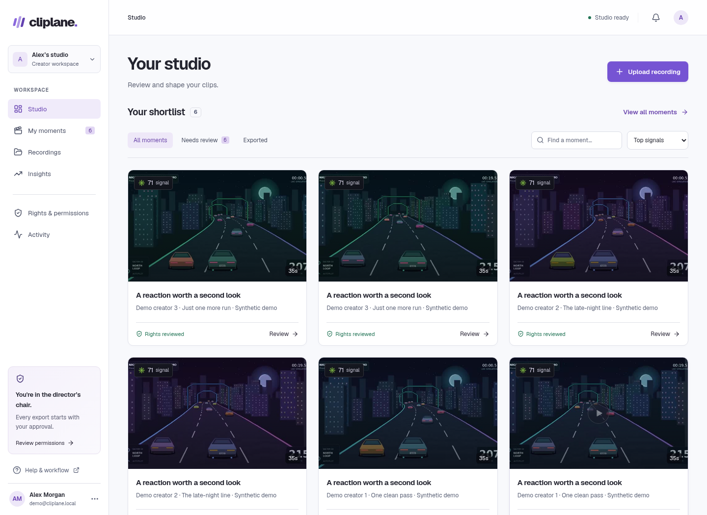

# Cliplane

**From recording to remarkable.**

Public source: https://github.com/jaydenpiao/cliplane · Apache-2.0.

A creator-controlled, rights-aware clipping studio for authorized gameplay and stream
recordings. Built from the supplied research report, following its first-iteration
scope: upload → probe → durable analysis → ranked moments → edit → review → render → download.

This is working local software, not a hosted production service. The interface uses
real PostgreSQL records and actual Python/FFmpeg processing. The demo contains original
procedural motion and generated audio, clearly labelled as samples.



See [verified results and review notes](docs/verification.md) for the tested checkpoint.

[Working demo](docs/demos/cliplane-demo.mp4) · [Agent handoff](docs/context/current.md) · [GitHub Project setup](docs/project/board.md)

Implementation and review evidence: [studio](https://github.com/jaydenpiao/cliplane/pull/31),
[streaming uploads](https://github.com/jaydenpiao/cliplane/pull/40),
[media cancellation](https://github.com/jaydenpiao/cliplane/pull/42).
See [DESIGN.md](DESIGN.md) for the light studio design and UI tools.

## Run it

Requires **Node.js 22.12+**, **Python 3.12+**, **FFmpeg/ffprobe with libx264 and drawtext**,
and **Docker Compose** (or your own PostgreSQL 17+ database). Linux/macOS are supported;
use WSL2 on Windows. Worker cancellation uses POSIX process groups.
The complete quality suite also uses uv for Python tooling.

```sh
git clone https://github.com/jaydenpiao/cliplane.git
cd cliplane
npm ci
cp .env.example .env
npm run db:up
npm run db:migrate
npm run seed
npm run dev
```

Open **http://localhost:3000**. Choose **Explore the sample studio**, or create your own
workspace. No API key, payment, OAuth application or social account is needed.
The API listens on loopback port 4000. The web server proxies `/api` on the same origin.

Use `http://localhost:3000`, matching `APP_ORIGIN`. If you use a different hostname or
port, update `APP_ORIGIN` and restart the API. Otherwise mutation requests are rejected.

Seeding is idempotent and preserves existing demo recordings. The demo account has a
random password and is accessible only through the development demo-session route.
It is shared local sample data: never put private footage in the demo workspace.

## What works

- Separate registered users and workspaces, scrypt passwords, hashed expiring sessions,
  HttpOnly cookies, same-origin mutation checks and rate limits.
- Streaming MP4/MOV/MKV/WebM/AVI uploads (2 GB default); actual video probing, SHA-256,
  creator provenance, versioned authorization, capture metadata and retention deadline.
- PostgreSQL durable jobs, atomic claims, leases/heartbeats, retry budget and manual
  failed-job recovery. Python workers never receive database credentials.
- A processing proxy, audio RMS/scene features, up to eight ranked windows, temporal
  suppression, persisted component scores and full-recording silent fallbacks.
- Responsive studio, search/filtering, recording library, processing activity and
  real workflow metrics. No invented audience analytics or virality claims.
- Versioned declarative edits: trim (100 ms–3 minutes), original/9:16 crop/blur/facecam,
  normalized manual crop, timed captions, audio mute. The editor labels source preview
  separately from the final rendered composition.
- Separate source/game/music/likeness/third-party/spoiler/embargo states. Human approval
  checks blockers and exact edit/rights revisions. Stale forms receive HTTP 409.
- Idempotent H.264/AAC MP4 rendering, reviewed authenticated previews/downloads including
  byte ranges; edits and rights changes revoke approvals and downloads of older edits.
- Raw retention/deletion sweeps with retryable storage cleanup and an audit trail.
- Offline ranking evaluation, media fixture tests, integration tests and CI.

## Deliberate boundaries

This is the report's **first vertical slice**, not all of its 90-day roadmap.
Transcription, learned/game-specific ranking, chat signals, object-store presigned
uploads, resumable uploads, storage imports, OAuth publishing, billing and team invites
are tracked with acceptance criteria in [GitHub issues](https://github.com/jaydenpiao/cliplane/issues).

The current baseline uses signal heuristics. It cannot infer music licenses, legal
rights, spoilers, a mission's meaning or whether a clip will perform well. Default
uploaded game/music rights are unknown. The creator records their review basis.
Muting removes **all** audio; separate mic/game stems and music-only removal are future work.
Static crop regions are implemented; tracked/keyframed crops and text overlays are later work.

There is no URL downloader, public-platform scraper or automated social posting.
Publishing interfaces live in the domain package; no real provider is configured.
Source deletion removes all media derivatives; an audit record remains. Account deletion,
email verification/password reset, backup deletion and legal policy deployment need
additional work before public beta. The legal templates are drafts, not legal advice.

## Verify

Start PostgreSQL first. Integration tests create and drop unique disposable schemas;
they do not truncate the development schema. Set `TEST_DATABASE_URL` to a dedicated
test database in shared environments.

```sh
npm run check
npm run evaluate
npm audit --omit=dev
# Running development servers and seeded local demo required:
npm run test:e2e
```

Browser tests use an existing Chromium installation via `CHROMIUM_PATH` (defaults to
`/usr/bin/chromium`). They create disposable local accounts and synthetic files, then
remove their source media. They never connect to a social platform.

## Repository map

```text
apps/web          Next.js / React studio
apps/api          TypeScript control plane, session auth, routes, durable job loop
workers/media     Stateless Python/FFmpeg CLI and offline evaluator
packages/domain   Validated versioned edit/rights contracts and publishing interface
packages/db       PostgreSQL migration and transaction boundary
packages/test-fixtures  Small synthetic evaluation inputs
scripts           Development orchestration, migration and synthetic demo seeding
infra             Local PostgreSQL Compose; application Dockerfile
docs              Architecture, ADRs, threat model, drafts, backlog and runbooks
```

Read [architecture](docs/architecture/overview.md), [security](docs/security/threat-model.md)
and [operations](docs/runbooks/local-and-production.md) before expanding the application.

## Production preparation

Do not expose the development demo to the public. Production startup requires
`DATABASE_URL`, HTTPS `APP_ORIGIN`, `COOKIE_SECURE=1`, and disabled demo access. Put the
API behind the web origin and isolate native media execution with CPU/memory/disk
quotas and no network access. A shared host additionally needs operational controls
listed in the threat model, object storage, backups and account recovery/deletion.

`npm run build` builds the web application. Run `npm run start:api` and
`npm run start:web` together. No production deployment is performed by setup.

Licensed under Apache-2.0. See [CONTRIBUTING.md](CONTRIBUTING.md).
